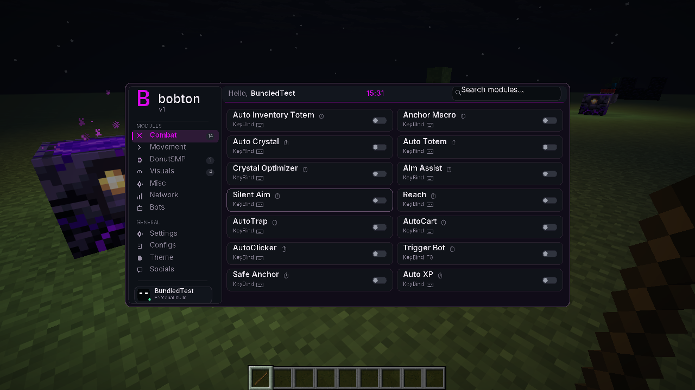
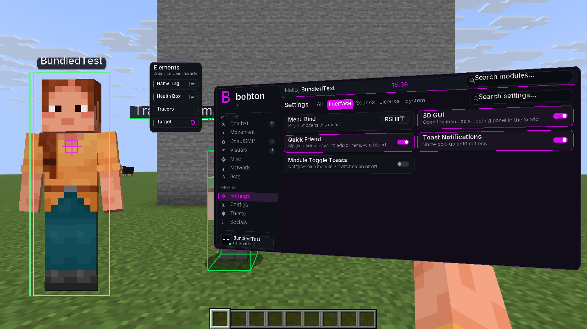
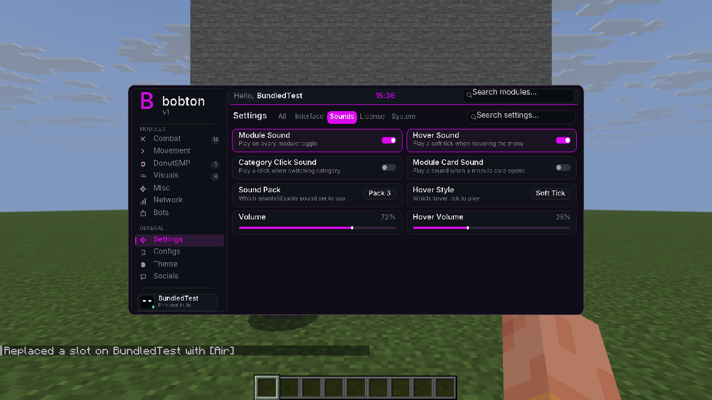

# bobton v1 — combat and settings update

Minecraft Java **1.21.11**, Java **21**, Fabric Loader **0.18.4 or later**.

Install **bobton-v1-1.21.11.jar** in your Fabric profile's `mods` folder, keeping one bobton/donut-scout client copy. **Fabric API is bundled; no separate API download is required.** The optional ZIP contains the same single JAR and installation instructions.

Press **Right Shift** for the compact menu. Enable **Settings → Interface → 3D GUI** for the perspective panel and player preview.

- Fourteen opt-in combat modules, with usage notes, real controls, and keybinds.
- Settings tabs: All, Interface, Sounds, License, System. Sound packs, hover styles, volume sliders, and notification controls.
- Player name/health overlays, boxes, tracers, target HUD, and clickable/draggable preview Elements.
- Friend editing, Quick Friend, Purple/Emerald themes, Panic, and session-only Self Destruct.
- Loaded-chunk finder, radar, and base evidence outlines.

Combat starts disabled. Actions use ordinary Minecraft interactions and server rules still apply. Reach changes client selection. Explosion guards check health/distance and nearby friends; they do not predict damage. AutoTrap places reachable supported blocks; move around the target to reach other faces. Self Destruct disables modules and hides the menu until restart without deleting files. Lifetime identifies a local build with no expiry; it supplies no commercial CORZ entitlement. Inter fonts recreate the reference style; original font/icon assets were not supplied.

Validation: **54 Java tests passed**. Tested the production JAR with no other installed mod files, including world loading, compact/perspective menus at 1280×720 and 854×480, native controls/persistence, module actions, visuals, Panic, session hiding/restart, and clean game exit. Multiplayer/server-specific effectiveness, audible output on the silent cloud display, and native Windows execution were not validated.

SHA-256 hashes are in `SHA256SUMS`.

