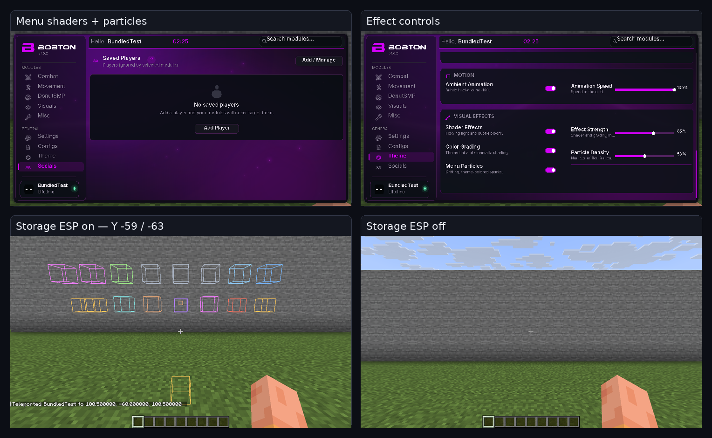
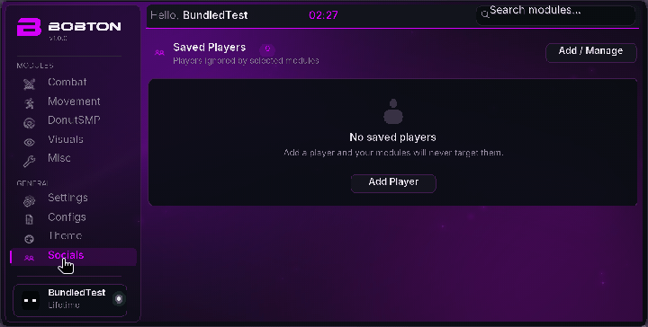
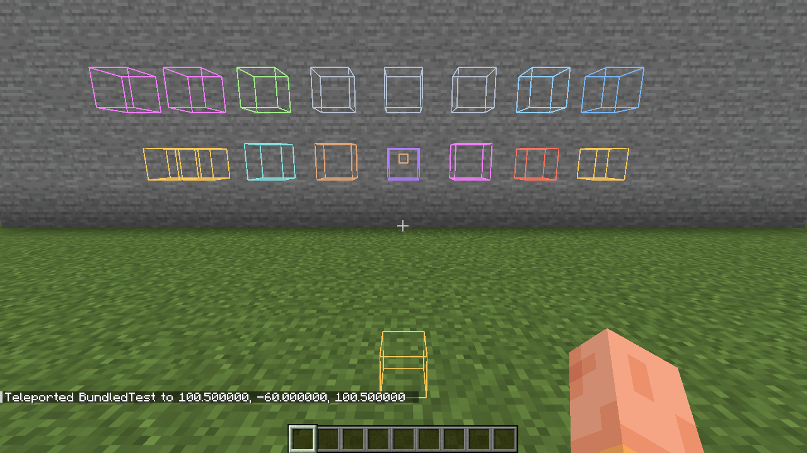
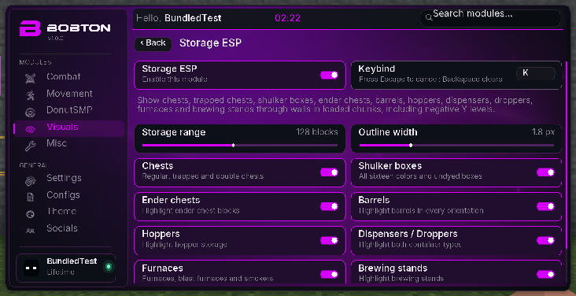
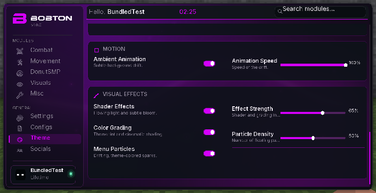

# bobton v1 — menu effects + Storage ESP

[Download the bundled JAR](bobton-v1-1.21.11.jar?raw=true) · [ZIP and installation guide](Bobton-v1-1.21.11-Bundled.zip?raw=true) · [SHA-256 checksums](SHA256SUMS)

Requires **Minecraft Java 1.21.11**, **Java 21** and **Fabric Loader 0.18.4 or later**. Fabric API is included. Move older bobton/donut-scout JARs out of the instance’s `mods` folder, copy in this single JAR, then launch and press **Right Shift**.

**Theme → Visual Effects** adds flowing GPU shader lighting, theme color grading/vignette and drifting glowing particles. Each effect has an independent toggle; effect strength and particle density are adjustable. All sixteen existing themes, branding, sounds, glass and ambient controls remain available. Effects work with the normal and perspective menus.

**Visuals → Storage ESP** adds colored through-wall outlines for regular/trapped/double chests, undyed/all dyed shulker boxes, ender chests, barrels, hoppers, dispensers/droppers, furnaces/blast furnaces/smokers and brewing stands. It supports the full loaded world height, including negative Y and containers buried below the player. Open the module card for eight type filters, 16–256 block range, outline width and keybind. Storage ESP starts disabled. It reads storage block entities from already-loaded chunks, independently of Chunk Finder scoring; it cannot display chunks the client has not received. Work and marker counts are bounded (4,096 visible/16,384 cached).

The old Chunk Finder text panel and radar remain removed. Existing combat/gameplay classes are unchanged; Storage ESP is the only new module.

**Validation:** all 68 Java tests pass. The production JAR ran with no separate mod/API file installed. Local Minecraft checks covered mixed containers hidden by solid stone at Y=-57/-59, a buried chest at Y=-63, module/keybind toggles, type/range filters, live block removal, distant teleportation, Nether/Overworld transition, shader/grade/particle controls, glass, perspective view and resizing between 1280×720 and 854×480. Minecraft exited normally. Downloaded JAR/ZIP bytes and CRCs were verified. Multiplayer server-specific behavior is not established by these local checks.

