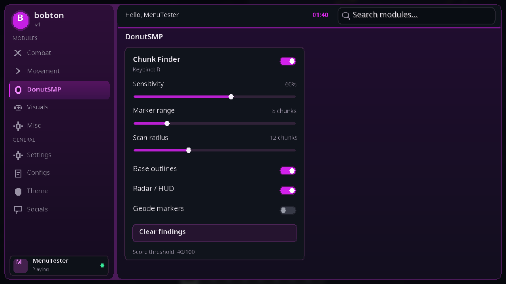

# bobton v1

Download `Bobton-v1-1.21.11.zip` and replace your previous mod JAR with the included JAR. Requires Minecraft Java 1.21.11, Java 21, and Fabric Loader 0.18.4 or later. Install the included Fabric API 0.141.6+1.21.11, keeping only one Fabric API JAR.

Right Shift opens the menu. DonutSMP contains Chunk Finder; B toggles scanning. Combat, Movement, Visuals, Misc, Settings, Configs, Theme, and Socials are empty clickable pages. The top bar shows your session username, live local time, and module/category search. Ctrl+K focuses search.

30 Java tests and in-game UI checks passed, including all sidebar pages, search, scrolling at two window sizes, native slider/switch controls, and settings persistence. Donut SMP multiplayer compatibility has not been tested. The preview uses a development test player; the game shows your actual session username.

