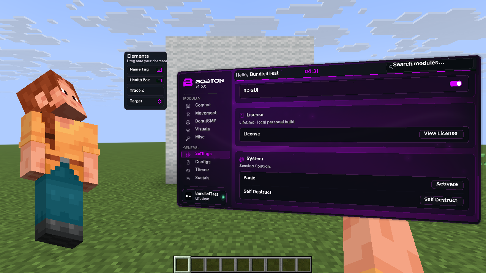

# bobton — direct keybinds and bold menu update

[Download the bundled client JAR](bobton-v1-1.21.11.jar?raw=true) · [ZIP and installation guide](Bobton-v1-1.21.11-Bundled.zip?raw=true) · [Checksums](SHA256SUMS)

For Minecraft Java 1.21.11 / Java 21 / Fabric Loader 0.18.4+. Fabric API is included. Replace the older bobton/donut-scout JAR with this one. Right Shift opens the menu.

**Hold C (or your assigned Zoom key) to zoom directly.** There is no separate Zoom enable switch. Release the key to return to normal view. Old saved disabled/toggle preferences no longer block hold-zoom. Right-click Zoom to configure its key, amount, smoothing, wheel adjustment and sensitivity.

**Other module keys toggle on a press.** They remain on after releasing the key and turn off on the next press. Right-click any module to configure its key and settings.

The menu uses genuine Inter Bold at weight 700 with fourfold glyph sampling and text shadows. Extra shader waves, animated edge highlights, a moving sheen and up to 96 glowing particles add detail. All 16 existing themes and the B/BOBTON artwork remain.

**Recording-specific work is still pending.** Both uploaded recording parts exceed the 32 MiB transfer limit, so their contents/settings have not been reviewed or matched. No new DonutSMP work was added. The permitted Fake Pay, Fake Stats and Name Protect additions remain pending accessible clips; other DonutSMP work is deferred.

[Download the Windows recording helper](Prepare-Recording-Clips.zip?raw=true). Extract it and run Prepare-Recording-Clips.cmd; choose the existing recordings. It creates ordered four-minute clips below 32 MiB without re-recording or changing originals. Conversion is local. If needed, it downloads FFmpeg from BtbN’s official GitHub build release into a temporary folder and verifies its SHA-256 checksum. Upload the generated clips, in batches if necessary. The conversion settings were checked locally; native Windows execution is not verified.

Validation: 88 Java tests pass. The production client was launched with only this JAR. Native checks confirmed C directly activates despite old disabled/toggle preferences, release restores the view, custom H works, and another module remains enabled after holding/releasing its key and toggles off on the next press. Bold fonts, new shaders and perspective rendering loaded without shader errors; Minecraft exited normally. Public JAR/ZIP bytes and integrity were verified.

