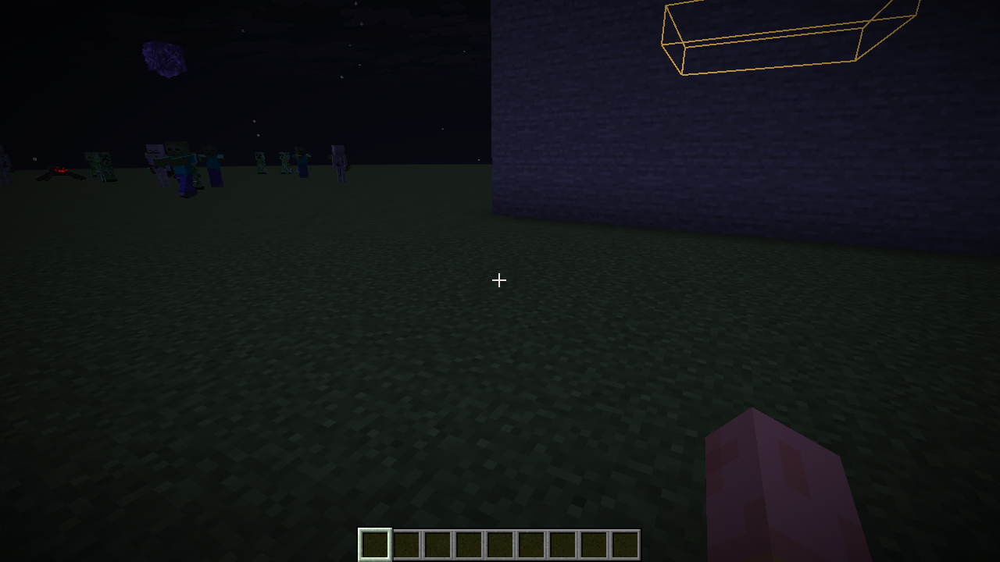

# bobton v1 — remove Chunk Finder panels

This update removes the CHUNK FINDER text panel and RADAR overlay shown in the screenshot. The renderer and its menu switch are removed, so old configs with showHud enabled cannot restore these panels.

Requires Minecraft Java 1.21.11, Java 21, and Fabric Loader 0.18.4+. Replace the old bobton/donut-scout JAR with bobton-v1-1.21.11.jar. Fabric API is bundled inside; install one client JAR. Right Shift opens the menu. The optional ZIP contains that same JAR and installation instructions.

No modules from the new video reference have been added. The requested video menu, themes, icons, branding/font, effects, and sounds are pending access to the actual video. This environment blocks YouTube; the clip must be supplied before those details can be matched.

54 Java tests passed. A production single-JAR Minecraft smoke test confirmed both overlays stay absent with an old showHud=true config, Right Shift still opens the menu, and the obsolete setting is dropped when saved. The removed renderer is absent from the JAR. The bundled Fabric API and all 43 nested modules passed payload integrity checks.

