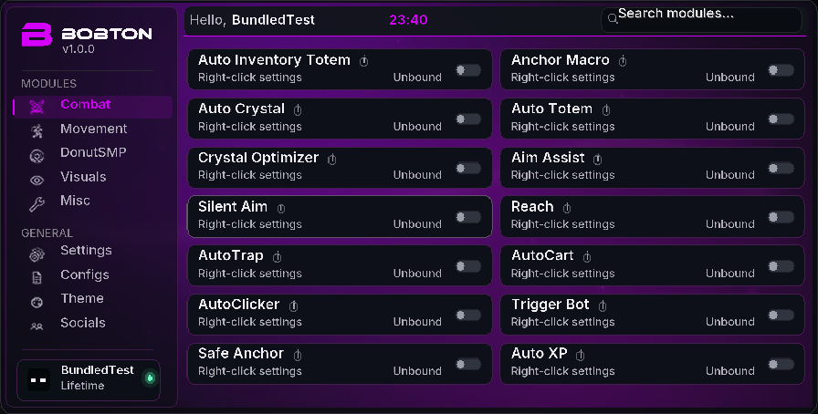
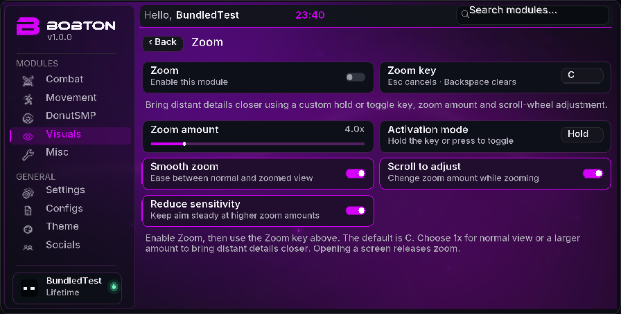
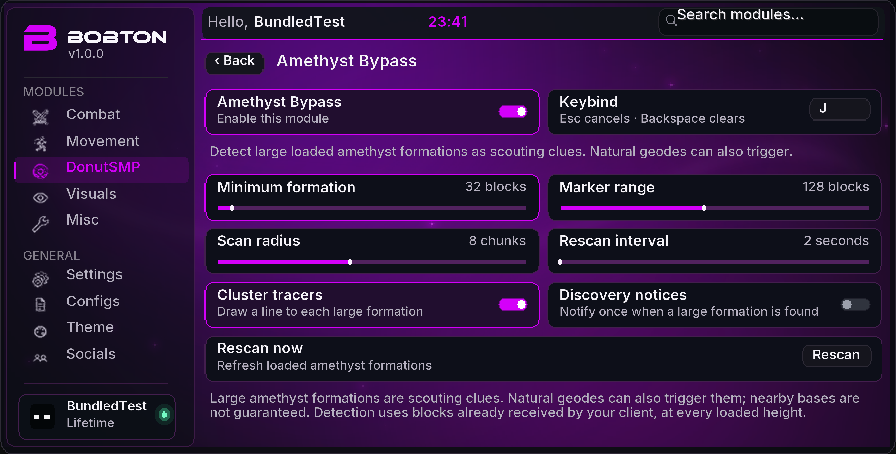

# bobton v1 — readable menus, right-click settings, Zoom and amethyst detection

[Download the bundled JAR](bobton-v1-1.21.11.jar?raw=true) · [ZIP and install guide](Bobton-v1-1.21.11-Bundled.zip?raw=true) · [SHA-256 checksums](SHA256SUMS)

Requires **Minecraft Java 1.21.11**, **Java 21** and **Fabric Loader 0.18.4 or later**. Fabric API is included inside the single JAR. Replace older bobton/donut-scout files in your instance’s `mods` folder with this JAR, launch and press **Right Shift**.

The menu opens larger and uses heavier Inter Medium text, brighter labels, increased glyph sampling and larger small labels. B/BOBTON artwork, all 16 themes, menu effects and Storage ESP remain available.

**Left-click toggles a module; right-click opens its settings.** Every one of the 22 modules has a settings page, also accessible from search. Keyboard users can focus a card and press Shift+F10 or the context-menu key. Player visuals now have independent ranges plus relevant label/size/color/width/friend controls.

**Visuals → Zoom:** enable the module, then hold **C**. Right-click Zoom to choose your activation key, hold/toggle mode, 1×–20× optical magnification, smooth transitions, scroll-wheel adjustment and reduced mouse sensitivity. Active wheel zoom consumes the wheel so your hotbar slot stays selected. Opening a menu, losing focus, disabling the module or disconnecting releases zoom; saved Minecraft FOV/sensitivity options are not changed.

**DonutSMP → Amethyst Bypass:** marks large connected loaded amethyst formations through walls with purple bounds and optional tracers/notices. Right-click for minimum formation size, range, scan radius, refresh interval and Rescan Now. All amethyst/bud growth stages are included, with grouping across chunk borders and negative Y. Natural geodes can also qualify: these are scouting clues rather than confirmation of nearby bases. Only blocks the client has received are inspected; server concealment and unloaded chunks are not bypassed. Scanning, grouping and cached positions are bounded.

**Validation:** all 86 Java tests pass. The production client ran with only this bundled JAR installed. All 22 settings pages were checked, including search and perspective input. Local world checks covered default/custom Zoom keys, hold/toggle, optical 4× magnification, wheel behavior, release/menu reset, independent player-visual preferences/ranges, and hidden amethyst formations crossing chunk borders at negative Y. Thresholds selected both test formations, only the larger formation, or neither. Marker presence stayed constant through 80 sampled frames across 8 seconds at a 2-second refresh; removing the formation cleared it. Resizing 1280×720↔854×480 and normal exit passed. Downloaded bytes and JAR/ZIP integrity were verified. Server-specific multiplayer behavior is not established by these local checks.

[All 22 module settings pages](all-module-settings.png)
