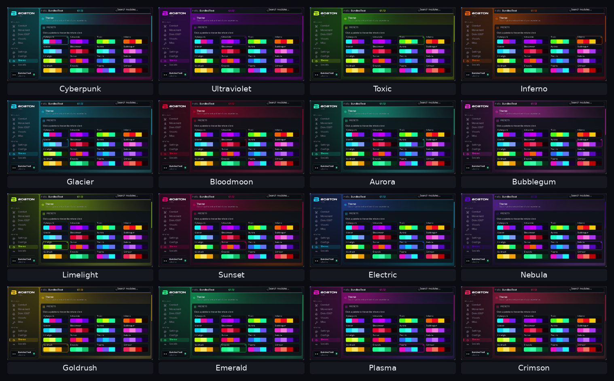
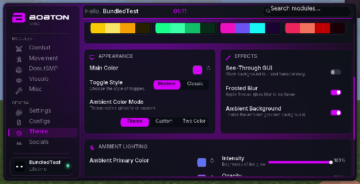
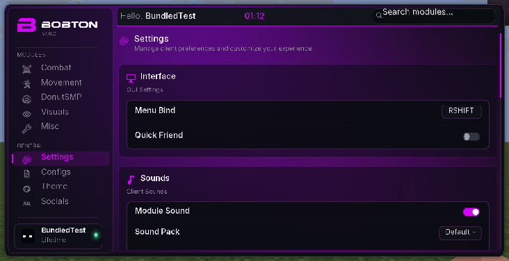
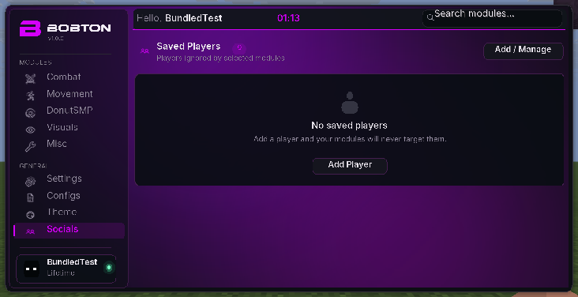

# bobton v1 — video menu update

[Download the bundled client JAR](bobton-v1-1.21.11.jar?raw=true) · [ZIP with installation instructions](Bobton-v1-1.21.11-Bundled.zip?raw=true) · [SHA-256 checksums](SHA256SUMS)

For **Minecraft Java 1.21.11**, **Java 21**, and **Fabric Loader 0.18.4 or later**. Fabric API is included inside the single JAR. Remove older bobton/donut-scout JARs from the instance’s `mods` folder, copy in this JAR, and press **Right Shift** in game.

The menu follows the three supplied recordings: all 16 four-color themes, B/BOBTON logo artwork in the identified branding font, the nine sidebar icons, vertical settings, recovered tick sounds, a live color picker, Modern/Classic switches, animated ambient lighting, and transparent/frosted surfaces. Theme controls apply throughout the menu and save locally. Local JSON profiles and saved players work. Community hosting requires the original service and is unavailable in this local build.

No gameplay modules from the recordings were added. Existing gameplay module classes are unchanged from the preceding HUD-removal release. The old Chunk Finder text panel and radar remain removed.

Colors and icons were sampled from compressed video; the menu tick was recovered from 31 repeated cues. These are reference-derived assets. The restricted branding font program is not embedded; only fixed PNG artwork is included. Body text uses licensed Inter fonts.

Validation: all 59 automated Java tests pass. The production client was launched with only this bundled JAR installed; theme, settings, profile, saved-player, glass, and resize checks were performed in Minecraft. Silent cloud audio was checked through decoding and sound-event loading rather than audible playback. JAR/ZIP integrity and downloaded bytes were verified.

